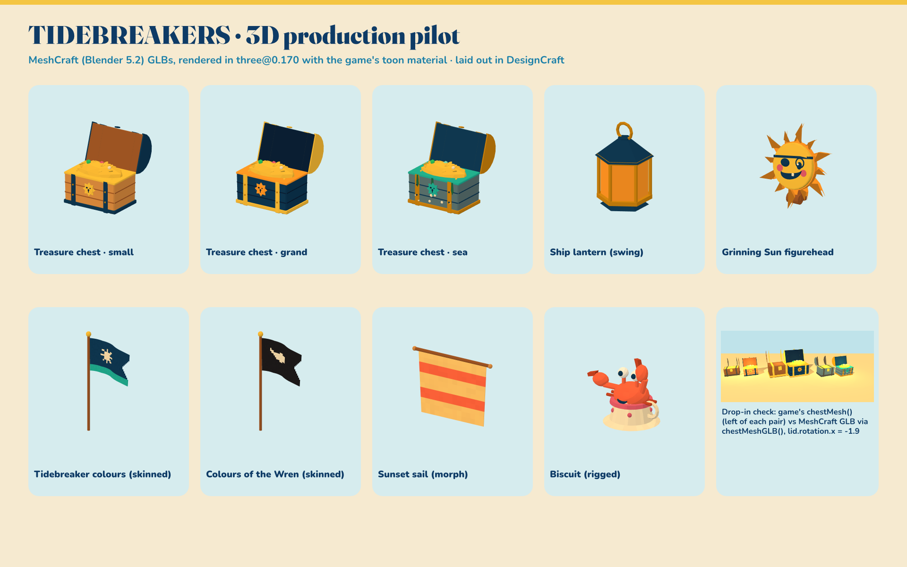

# GITCRAFT 3D pilot: TIDEBREAKERS

*2 November 2026. Second GITCRAFT production run and first in 3D. Built on the v1 creative package (`creative/REPORT.md`).*

**Bottom line:** GITCRAFT now has a real 3D production tool, **MeshCraft**: Blender 5.2 LTS, headless, under the same kernel sandbox as the 2D tools.

It produced 9 TIDEBREAKERS 3D assets from the existing creative package, and every one passes three gates:
- MeshCraft validation;
- the Khronos glTF-Validator (**0 errors, 0 warnings on all 9**);
- an engine check in the game's own three.js version, with the game's toon material.

**The treasure chest is a verified drop-in for the game's `chestMesh()`.** Running through the game's real code, the lid pivot is identical for all three tiers and the same `lid.rotation.x = -1.9` opens it. The game itself was not changed.

## 1. What was discovered

| Finding | Consequence |
|---|---|
| GITCRAFT had no 3D tooling; 7 ArtCraft tools are all 2D/2.5D (EffectCraft can import glTF but not author) | Needed a dedicated tool, not an extension of an existing one |
| Blender's own download site is blocked by the network proxy, but **PyPI's official `bpy` wheel** (Blender as a Python module) installs and runs headless on CPU | MeshCraft = `bpy` 5.2.3 LTS in a venv, no compiled artifact, no GPU |
| Portfolio survey: **13 games use Three.js**, none use another engine, **none load glTF yet** (all procedural) | Primary export = GLB for Three.js; others are configurable profiles; each game needs a one-time GLTFLoader adoption |
| TIDEBREAKERS shades everything with `MeshToonMaterial({vertexColors})` + a 4-band gradient (`src/world/materials.ts`) | Exports bake palette colours into glTF `COLOR_0` (linear), so the game's own `vcMat()` renders them exactly like its procedural geometry |
| `chestMesh()` has a precise contract: `{root, lid, glow}`, lid pivot `(0, 0.8·s, −0.45·s)`, opened by `lid.rotation.x = −1.9`, tiers s = 1 / 1.5 / 1.1 | The chest template reproduces it exactly, which makes it a drop-in candidate |
| The kernel has **Landlock** (ABI 7) | Security can be enforced centrally by the kernel, including for Blender's Python and headless Chromium |
| FilmCraft and LightCraft had **no file fence**; tools didn't install in multi-repo sessions or connect until `/mcp` | Fixed (see §7) |

## 2. What was implemented

**GITCRAFT (merged PRs #4–#8):**
- **#4 Central security and lifecycle:**
  - a Landlock sandbox for every tool (filesystem + no network);
  - an MCP guard with readable refusals, a per-tool deny list and a hashed audit log;
  - a pre-session installer (`setup-env.sh`), plus `doctor.sh` and `status.json`;
  - an end-to-end policy test.
- **#5 MeshCraft** (14 MCP tools):
  - brief schema and a palette loader (ASE/CSS/GPL/JSON);
  - modelling kit and 6 templates (prop, ship parts, skeletal flag, morph sail, rigged character);
  - Cycles previews with navy outlines and contact sheets beside the 2D references;
  - validation, 5 export profiles, LODs, convex collision, the Khronos validator and the three.js engine check;
  - manifest updates and `run_script` for assisted modelling;
  - docs and the 3D roadmap.
- **#6:** Biscuit's arm axis corrected (twist → lift); hanging and mounted assets exempt from the ground check.
- **#7:** user fonts visible inside the sandbox. This was a regression from #4, now covered by a pixel test.
- **#8:** skinned meshes at the glTF root (Khronos warning fixed); no empty LODs for skinned assets.

**TIDEBREAKERS (this PR, `creative/3d/` only):**
- 9 assets, with briefs, sources, exports, previews, engine checks and reports;
- the drop-in loader (`integration/chestGLB.ts`) and its verification kit;
- the 3D board;
- `HANDOFF.md` and this report;
- 112 manifest entries.

## 3. Files generated (all real; see `MANIFEST.json`, paths under `3d/`)

| Asset | Template | Triangles | Clips | GLB (three-web-toon) | Extras | Validation | Engine check |
|---|---|---|---|---|---|---|---|
| tb_chest_small | chest | 2,456 | lid_open, lid_close | 183 KB | LOD 1,228 / 604, hull 156; + atlas GLB, Godot GLB, FBX, OBJ | 27 pass, 0 fail | all pass |
| tb_chest_grand | chest | 2,456 | lid_open, lid_close | 183 KB | LOD 1,228 / 604, hull 156 | 17 pass, 0 fail | all pass |
| tb_chest_sea | chest | 2,800 | lid_open, lid_close | 216 KB | LOD 1,400 / 682, hull 156 | 17 pass, 0 fail | all pass |
| tb_lantern | lantern | 396 | swing | 36 KB | LOD 198 / 91, hull 56; + FBX | 17 pass, 0 fail | all pass |
| tb_figurehead_sun | sun_figurehead | 1,960 | — | 141 KB | LOD 980 / 490, hull 128; + FBX | 15 pass, 0 fail | all pass |
| tb_flag_tidebreaker | flag (skinned) | 3,096 | wave | 341 KB | hull 66 (LODs skipped: skinned); + FBX | 16 pass, 0 fail | all pass |
| tb_flag_wren | flag (skinned) | 3,096 | wave | 340 KB | hull 66 (LODs skipped: skinned) | 16 pass, 0 fail | all pass |
| tb_sail_sunset | sail (morph) | 940 | fill, luff | 109 KB | LOD 470 / 234, hull 68 | 15 pass, 0 fail | all pass |
| tb_biscuit | crab (rigged) | 2,132 | idle, wave, snap | 249 KB | hull 136 (LODs skipped: skinned); + Godot GLB, FBX | 22 pass, 0 fail | all pass |

**Per asset:**
- `source/<id>.blend` (editable);
- `exports/`;
- `previews/`: 4 views + animation poses + a contact sheet with the 2D references;
- `engine/`: three.js renders at rest and mid-animation, plus an engine-check JSON;
- `<id>.meshcraft.json`: every step, check, timing and SHA-256.

**Plus:**
- `board/` (laid out by DesignCraft);
- `integration/`: the loader, a side-by-side render with the game's own chests, and the verification kit;
- `briefs/`.

## 4. Which tools exchanged files

| From → to | What | Evidence |
|---|---|---|
| VectorCraft → MeshCraft | brand palette (`creative/branding/palette/tidebreakers-palette.json`, exported by VectorCraft in v1) became every material role | role colours in each `.meshcraft.json` |
| VectorCraft / PhotoCraft / LightCraft → MeshCraft | 2D references (UI kit, ship cosmetics, emblem, character art, graded environments) attached to the `.blend` and shown on each contact sheet | `references` in each brief |
| MeshCraft → three.js engine check | GLBs loaded, animated and screenshotted | `engine/*.json` |
| MeshCraft → DesignCraft | engine renders laid out into the 3D board | the guard's audit log shows **identical SHA-256** at MeshCraft's output and DesignCraft's input for all 10 placed images |
| MeshCraft → the game's own code | chest GLBs through `chestGLB.ts` beside `chestMesh()` | `integration/dropin_*.png`, hinge table in `integration/verify/README.md` |

The audit log also **caught a stale handoff**. Biscuit and the flags were regenerated after the first board was laid out, so their hashes no longer matched. The board was rebuilt and now matches 10/10.

## 5. What remains manual

- **Writing briefs and choosing templates.** That's art direction, done by Claude in this run.
- **New asset types** need a new template, or a `run_script` session (Blender Python in the workspace).
- **Visual review.** Every contact sheet and engine render was inspected. That review caught five real bugs the numeric checks missed:
  - an inverted preview camera;
  - a lid vault built in the wrong plane;
  - the rest pose saved at the last keyframe;
  - coins orbiting the world origin;
  - Biscuit's arms twisting instead of lifting.
- **Engineering adoption** of the GLBs: the `HANDOFF.md` steps.
- **Organic sculpting, retopology, painted textures and weighted (non-rigid) skinning:** artist work in Blender, using the `.blend` sources.

## 6. Capabilities that would need external services

None were used; everything ran locally on CPU. `docs/3d-roadmap.md` in GITCRAFT has the details.

| Capability | Needs | Status |
|---|---|---|
| Image-to-3D / text-to-3D | paid hosted API (per-generation credits, sends art to a vendor, needs a sandbox network exception) **or** open-weight models needing an NVIDIA GPU (~8–24 GB VRAM) | experimental; approve cost and data-sharing first; treat output as a blockout |
| AI texturing | GPU or paid API | not needed for the vertex-colour style |
| Music / SFX | paid API or GPU models; free option: procedural SFX (the game already synthesises audio) | recommend a procedural SFX tool first |
| Mesh compression (Draco / meshopt) | not in the PyPI `bpy` build | uncompressed GLBs (36–341 KB) |

## 7. Security and permission changes

**Every GITCRAFT tool now runs as `guard → Landlock sandbox → server`:**
- It can read system directories, and read and write **only** the authorized roots (`GITCRAFT_ROOTS`; this run used the TIDEBREAKERS repo alone) plus its own state folder.
- **Network is denied.** This is enforced by the kernel for the tool and all its children: Blender's Python, `run_script` and headless Chromium.
- **FilmCraft and LightCraft are fenced** for the first time. Their kernel-only test returned `Permission denied (os error 13)`.

**Tests:**
- `tests/test_policy.py`: 17/17, all 7 ArtCraft tools plus the font regression.
- `tests/test_meshcraft.py`: 12/12. A hostile `run_script` cannot read `~/.claude.json`, write `/tmp`, or open a socket.

**Lifecycle:**
- `setup-env.sh` installs and registers before the session, which fixes multi-repo sessions and the "connect after `/mcp`" problem. It was tested end to end from GitHub with a clean home.
- `doctor.sh` reports health; the audit log hashes every handoff.

## 8. Next recommended pilot

**3D ship progression: dinghy → sloop as data-driven 3D hulls.**
- Build a parametric `ship_hull` template from the v1 ship sheet (length, beam, sheer, rake, hull paint) that reuses this pilot's sail, flag, lantern and figurehead parts.
- Target `src/ship/shipModel.ts`'s contract: upgrade slots and cosmetic colours from `src/data/ship.ts`.
- Pair it with the **first engineering adoption**: the chest GLBs behind a flag via `chestGLB.ts`. That proves the asset path end to end in production before the hull work lands.

Ships are the game's core fantasy and its most-seen asset. They exercise modular kits, cosmetics and upgrade visuals, which is the next level of difficulty for MeshCraft.
