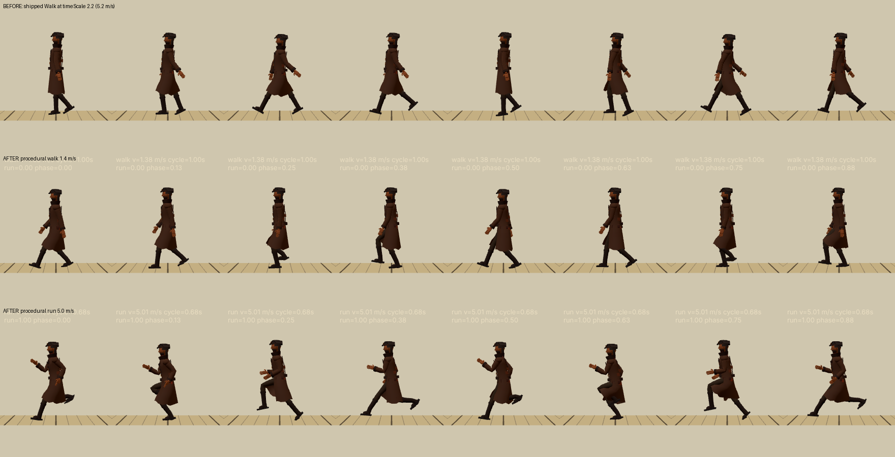
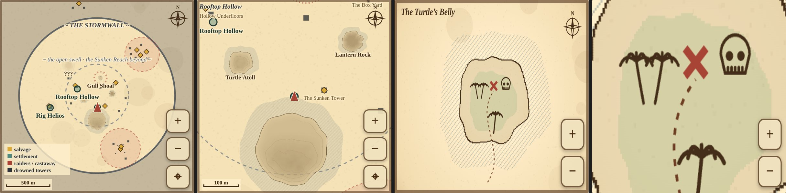
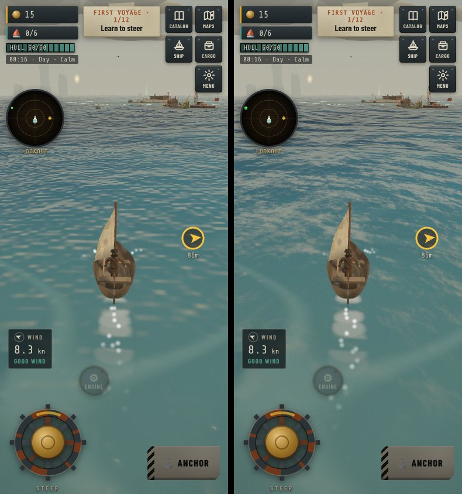

# Expedition pass: locomotion, pinch-to-zoom maps, the sea

A GITCRAFT world-building and gameplay pass, prioritised from an audit of the running game on an iPhone-sized
viewport. Everything here was measured before and after; the screenshots are in `screens/`.

## 1. The captain ran like a puppet: root cause and fix

**What we measured** (bone positions sampled from `tb_captain.glb` through three.js's `AnimationMixer`):

| | Before |
|---|---|
| Clips | Idle, Walk, Sit, Dig, Cheer, Interact. **No Run.** |
| Walk's own speed | ≈1.31 m/s (stance foot travels 0.84 m in 0.62 s, at the captain's 0.972 scale) |
| On-foot speed | 5.2 m/s at full stick, reached **instantly** (no acceleration) |
| Playback | Walk at `timeScale = 0.75 + speed × 0.28` = 2.2× |
| Result | feet move at ~2.9 m/s under a body moving 5.2 m/s: **~2.3 m/s of skating**, at ~4 steps/s |
| Pelvis | rotation exactly 0,0,0 all cycle; never shifts sideways: **locked hips, no weight transfer** |
| Swing foot | mid-swing ankle 0.14 m vs 0.28 m at toe-off: the foot shuffles along the ground |
| Facing | moved in the stick direction immediately while the body turned after it (sideways glide) |

So "puppet" was not one thing: a walk clip played at double speed for a run, feet sliding, a rigid pelvis and
torso with limbs cycling on it, and a body that teleported between speeds.

**The fix** (`src/player/gait.ts`, `src/player/captain.ts`, `game.ts → updateFoot`):

- **Walk and Run are generated on the actual skeleton** at load (22-bone Mixamo-named rig; `captureRest` measures
  thigh 0.40 m, shin 0.42 m, ankle 0.10 m). Each foot's stance is fixed in the ground frame (heel strike → flat →
  toe-off, rocking over the heel and then the ball) and the legs reach it with **two-bone IK**, knees always
  forward. A planted foot cannot slide when the clip plays at its own speed.
- **Pelvis height comes from physics, not a sine:** the walk is an inverted pendulum (pelvis highest at mid-stance,
  limited by leg reach, 3.3 cm travel); the run is spring–mass (compressed at mid-stance, highest in a real
  **flight phase**, 8 cm travel).
- **Weight and counter-rotation:** the pelvis yaws toward the stepping leg, drops on the swing side and shifts over
  the stance foot; the chest counter-rotates; the arms swing against the legs (relaxed elbows walking; ~85° pumping
  elbows, crossing toward the midline, running); the trunk leans (3° walking, 11° running) with a small bounce at
  each landing; the head stays level.
- **Run swing:** the heel folds up behind the hip, then the knee drives through and the shin reaches to land.
- **Playback is phase-locked to ground speed.** Walk and Run share one phase; the blend weight comes from speed and the
  cadence is set so that blended stride × cadence = speed exactly (`strideAt`). Heel strikes at phase 0 and 0.5 fire
  footstep events.
- **Weights are normalised** every frame across Idle / Walk / Run / Dig / Sit / Cheer, so the T-pose bind can never
  leak through a cross-fade.
- **Momentum:** 9 m/s² acceleration, 14 m/s² braking, a turn rate that slows with speed, a plant-and-pivot on hard
  reversals, and the captain always moves the way they face. The legs animate at the speed actually covered, so
  pushing into a rock doesn't run on the spot. Top speed is 5.0 m/s (was 5.2), where the run's stride and cadence put it.
- **Lean:** into turns (centripetal, `atan(v·ω/g)`) and into acceleration and braking, pivoting at the feet.
- **Footsteps:** a dry sand crunch or a wet slap in the shallows on every heel strike, heavier when running; a small
  splash when wading.
- **Camera:** on foot, the camera now lifts over a dune that would block the line of sight to the captain (it used to
  check only its own position against the ground).

**Verified, not assumed** (`tests/gait.test.ts`, run on the real GLB after the mixer evaluates):
planted flat foot drifts < 2 cm and the ball of the foot < 3 cm over each stance (both gaits, both legs, including the
stance that wraps the loop point); pelvis yaw > 0.12 rad and roll > 0.08 rad of travel; knees never bend backwards;
hands clear the body; the run is airborne for part of every step and the walk never is; swing clearance > 0.17 m
(walk) and > 0.4 m (run, heel kick); pelvis bounce within human ranges and in the right phase for each gait; cadence ×
stride equals speed across the blend; the rest pose is measured correctly even when the rig is already placed in the
world. That last test exists because the first in-game run showed the captain had vanished: the rest pose had been
captured in world space, so the Hips track threw the body 131 m away. The test caught it after that.
The e2e suite now checks that the captain accelerates (not instant), reaches the run, and brakes to idle.

`tools/gait-lab.html` (dev only: `npm run dev` → `/tools/gait-lab.html?mode=old|walk|run|blend&v=3&view=side|three|front`)
renders the rig over ground lines that scroll at body speed, so foot sliding is visible by eye. That is where the
frame strips in `screens/gait_*` come from.

Known limits: the coat tails are skinned to the thighs (MeshCraft weights), so they kick out behind the leg in the run's
recovery; fixing that means re-weighting the mesh. The procedural gait is for flat-ish ground; there is no foot IK
against slopes yet. Crew and townsfolk still use their authored clips (they don't run).

## 2. Pinch-to-zoom maps

**Before:** the world chart was a fixed 480 px bitmap scaled into the panel: islands as circles, ~1 px salvage
sites, and labels drawn over each other ("Rooftop Hollow" twice on top of itself). The treasure maps were the same.

**Now** (`src/ui/mapView.ts`, `src/ui/mapArt.ts → paintWorldChart`):
- **Two-finger pinch** zooms about the fingers' midpoint and follows it as it moves; **one finger** pans;
  **double-tap** zooms 2× at the tap (and back out from max zoom); **+ / − / ⌖** buttons (44 px) zoom and find your
  boat; mouse wheel and drag on desktop. The world chart zooms 1–8×, treasure maps 1–3×; pan is clamped so the map
  never leaves the frame; zooms ease; the view is remembered between openings.
- **The map owns its touches** (`touch-action: none`, captured pointers, iOS `gesturestart` blocked): the game's camera
  gestures are bound to the WebGL canvas only and steering is paused while a panel is open. The e2e test checks that a
  real two-finger pinch leaves the camera yaw, camera zoom, helm and page scale exactly unchanged.
- **Crisp at every zoom:** the chart is repainted as vectors for each view at device pixel ratio, not a scaled bitmap.
- **Real coastlines:** each island's coastline, shallows hatching and 3 m contour lines are baked from the game's
  heightfield (the same one you walk on), up to 2 px/m. The bake runs in ~10 ms slices across frames on the first
  open, so the chart never stalls (it was ~250 ms in one go).
- **Readable at every zoom:** marks stay a constant size on screen; labels are placed by priority (settlements →
  islands → places → site names) and try below, above, right and left of their mark before giving way; they keep
  clear of your boat, clamp inside the frame, and a settlement never gets a duplicate island or place label. Raider
  waters and salvage site names appear as you zoom in; a scale bar (10 m – 1 km) updates with zoom; the legend hides
  on small surfaces.
- Treasure maps render at 2× with a finer coastline (one height grid feeds the shading and the outline: fewer samples
  than the old 1× map).

## 3. The sea

The ripple detail was value noise (nine evaluations, ~36 `sin()` hashes per pixel). It read as blobby up close and
flat in the middle distance. It's now a **Tessendorf FFT chop tile from GITCRAFT WorldCraft** (`creative/ocean/`), sampled
at two scales drifting across each other along the wind, with distance fades. The result is real wind-driven chop with
crest highlights and dark troughs that recede into texture toward the horizon, for two texture fetches. It holds up
at dusk and night, and the wake visual check still passes for all three vessels.

## GITCRAFT tools used
- **StudioCraft WorldCraft `ocean`**: the FFT chop tile (and its loop/tile/spectrum/engine checks).
- **StudioCraft TestCraft `smoke`**: the production build on phone and phone-landscape: no page errors, no missing
  files, no horizontal overflow, canvas renders. Its only failure is the Google Fonts stylesheet, which the
  sandbox (no network) blocks.
- **AssetCraft**: the WorldCraft run registered its outputs in the catalogue with hashes and licence.
- **MeshCraft / AnimCraft** finished installing mid-session (Blender bpy). AnimCraft's procedural `run` clip was not
  evaluated: the fix needed foot contacts solved against this rig's measured legs and playback phase-locked to the
  game's ground speed, so the gait is generated in code at load and measured on the shipped GLB (`tests/gait.test.ts`).

## Checks
- `npm test`: 289 passed (9 new gait tests).
- `npm run build`: passes (typecheck + production build).
- `node tests/e2e/play.cjs`: 30/30 in mobile Chromium (iPhone UA, 390×844, touch), including the new run/brake and
  pinch/pan/isolation checks.
- `npm run check:visual`: PASS (wake never sprays over the hull; noon/dusk/night shots for all three vessels).
